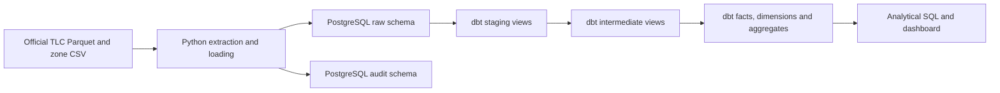

# Architecture and initial data contracts

Status: proposed design following the approved Milestone 1 plan. Only source inspection is implemented.

## Environment and layers

Docker Compose will provide PostgreSQL, plus commands/services for ingestion and dbt. Environment variables configure connections; credentials must never enter Git. Development and CI will use separate databases and configurations. PostgreSQL is the only local warehouse. BigQuery is deferred until local completion.

Raw data preserves source values and ingestion lineage. Staging standardizes names and types and adds quality flags. Intermediate models contain reusable calculations. Marts expose documented analytical contracts. Views are the initial default for staging/intermediate; facts and aggregates may be tables. Materialization choices will be measured later.

## Identity, idempotency, and source changes

No documented business trip identifier is present. Proposed technical identity is `(logical_source_file, source_row_ordinal)`, represented as a deterministic `trip_record_id`. The ingestion implementation must preserve physical Parquet row order explicitly; an unordered SQL row number is insufficient. A source checksum identifies file versions separately. This key identifies a source record, not a real-world trip across revised files.

For each file, retain URL, logical identifier, checksum, observed schema, run timestamps, status, and row counts. Skip an unchanged successfully loaded version. Load a revised version into a temporary batch, validate it, then transactionally replace that logical file's active batch. Keep audit history. A failed replacement must retain the previous active version. Do not deduplicate identical business attributes without evidence that they represent duplicates.

Validate expected required columns and compatible types before loading. Preserve and record additive columns; block incompatible structural changes with actionable diagnostics. Structurally unreadable files fail the batch. Row-level malformed values must be retained in raw where representable or quarantined with rejection reasons and reconciled counts. Domain anomalies are flags, not automatic deletions.

## Planned model grains and relationships

| Model | Grain | Key / relationships |
|---|---|---|
| `fct_trips` | One retained source record | `trip_record_id`; pickup/drop-off zone keys; pickup/drop-off date keys |
| `dim_pickup_zone` | One lookup location ID | `location_id` |
| `dim_dropoff_zone` | One lookup location ID | `location_id` |
| `dim_date` | One calendar date | `date_key`, unique calendar date |
| `mart_daily_demand` | One pickup date | `date_key` |
| `mart_zone_performance` | One date, location, and pickup/drop-off role | Composite key; role determines which event timestamp supplies the date |
| `mart_revenue_trends` | One pickup calendar month | Unique month |

Zone dimensions are role-playing projections of the same lookup. Do not sum pickup-role and drop-off-role revenue as if they were separate transactions. Unknown or future unmatched IDs need explicit handling without dropping trips. No SCD Type 2 or snapshots until genuinely mutable attributes justify history tracking.

## Metric contracts to finalize with the learner

- Observed demand: count of records eligible for the specified demand measure, attributed to pickup local date/time. It does not measure unfulfilled requests or total market demand.
- Recorded fare: sum of `fare_amount`; signed adjustments remain visible.
- Recorded passenger charges: sum of `total_amount`; not company net revenue. Do not add tips again to this total. Cash tips are absent from source totals.
- Duration in minutes: drop-off minus pickup, only when both timestamps exist and drop-off is later. Invalid duration does not automatically invalidate financial measures.
- Distance: miles; zero distance remains visible and is excluded from division by distance.
- Card tipping rate: sum of recorded tips / sum of positive fares for credit-card records with positive fares and nonnegative tips; report eligible record count. Never infer cash tipping from this field.
- Average fare/duration: sums divided by the count eligible for the same measure. Never average pre-aggregated averages without their denominators.

Preserve timezone-naive source timestamps. Treat NYC local wall time as an explicit analytical convention and document ambiguity around daylight-saving transitions; do not label source times UTC. Keep ingestion timestamps UTC. Convert source floating-point monetary values to documented fixed-precision numeric types in staging, preserving the raw values and declaring rounding behavior.

## Initial quality proposal — pending learner review

Preserve all January-file records in raw and the planned fact, with flags. Attribute analytical periods by event timestamps rather than file names. Keep out-of-file-month records visible. Retain missing passenger counts as null, not zero. Investigate negative amounts and zero distance before applying business exclusions. Metric-specific eligibility is preferable to one universal valid-trip filter.

Planned tests include key uniqueness/non-nullness, zone/date relationships, documented payment values, source/loaded/rejected reconciliation, and idempotent reruns. Profile-derived counts are observations for a particular checksum, not universal assertions for every month.

## Incremental processing and freshness

Drive future incremental processing from changed ingestion batches, not just maximum pickup time. Replace changed fact batches and recompute aggregate periods touched by both the old and new batch, including cross-month event dates. Test revised files and late-arriving records. Compare full refresh and incremental results on identical inputs, then measure runtimes; no improvement is claimed yet.

Historical event timestamps alone are unsuitable for a live freshness SLA. Validate expected batch arrival and ingestion completion when scheduling exists. Plan a custom dbt safe-division macro and generic plus singular tests in later milestones.

## Trade-offs and limitations

Batch replacement simplifies correctness without a stable business key, but reloads whole files. Raw retention improves auditability at a storage cost. PostgreSQL makes local learning accessible, but cloud-scale performance is unproven. Three months allow limited temporal comparisons, not annual seasonality. Operational resource allocation claims require additional information about supply and unmet demand.
